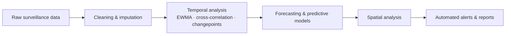

 

---

## 👋 About me

I'm a **Statistical Programmer and Research Assistant** at the **Tata Institute for Genetics and Society (TIGS)**. I design analytics that help public health teams **spot infectious disease trends earlier and act with confidence**.

Before public health, I worked as a **Marketing Analyst**, turning Amazon sales and campaign data into customer segments, A/B test results and KPI dashboards. That taught me to explain statistics to non-statisticians, a skill I rely on every day.

---

## 📊 Impact in numbers

| 🦠 **17** | 📅 **15 yrs** | 🔔 **40%** | 🧠 **13** | 🗺️ **3** |
|:---:|:---:|:---:|:---:|:---:|
| diseases covered | of surveillance data validated | fewer false alerts | forecasting models benchmarked | spatial analysis methods |

---

## 🚀 Flagship project: EpiAlertR

> An end-to-end infectious disease **surveillance, forecasting and early-warning framework**, built with R, Shiny, PHP and JavaScript.

| | |
|---|---|
| **Problem** | Surveillance data is messy, and noisy signals lead to false alarms that erode trust |
| **Data handling** | KNN, mean / median / mode and forward / backward interpolation for missing data |
| **Early warning** | EWMA monitoring + cross-correlation + changepoint detection to separate real outbreak signals from noise |
| **Modelling** | 13 models benchmarked: ARIMA / ARIMAX / SARIMA / SARIMAX, LM, GLM, GAM, Bayesian regression, Random Forest, XGBoost, SVR, KNN, LSTM |
| **Spatial** | Choropleth mapping, Global Moran's I and Anselin Local Moran's I (LISA) across 8 districts and 9 diseases, identifying High-High, Low-Low, High-Low and Low-High clusters |
| **Result** | **40% fewer false alerts**, validated on **15 years of data across 17 diseases**, with reproducible reporting that runs in minutes |

`R` `Shiny` `PHP` `JavaScript` `Time Series` `Bayesian` `Spatial Analysis`

---

## 💼 Experience

**Research Assistant (Statistical Programmer)** · Tata Institute for Genetics and Society · *Jun 2025 – Present*
- Designed and built EpiAlertR for infectious disease surveillance, forecasting and early-warning alerts
- Applied spatial autocorrelation methods to pinpoint high-risk clusters and outliers for targeted public health response
- Automated the full pipeline (cleaning → modelling → visualisation → reporting), turning hours of manual reporting into minutes
- Worked with epidemiologists and entomologists to translate model outputs into operational decisions

**Marketing Analyst** · Dom Ventas · *Jul 2024 – May 2025*
- Analysed Amazon sales and advertising data with SQL and Excel (Power Query, Pivot Tables) for weekly and monthly sales reporting
- Built KPI dashboards tracking ACOS, ROI, sales growth and conversion
- Segmented customers by behaviour and purchase patterns to inform targeted campaigns
- Ran A/B tests and worked with sales, product and marketing teams to turn analysis into decisions
<!-- ADD (only if you can verify them): numbers such as campaigns analysed, teams served, reporting time saved, conversion lift -->

---

## 🧰 Tech stack

| Area | Details |
|---|---|
| **Forecasting** | ARIMA family, LSTM, XGBoost, Bayesian methods, multi-horizon and walk-forward validation |
| **Epidemiology** | Surveillance analytics, early-warning systems, EWMA, changepoint detection, cross-correlation |
| **Spatial** | Choropleth mapping, Moran's I, LISA clusters |
| **Data & BI** | Imputation, KPI dashboards, A/B testing, customer segmentation |
| **Academic exposure** | SAS and CDISC standards |

---

## 📂 More projects

| Project | Description | Stack |
|---|---|---|
| [🌐 Portfolio](https://github.com/divakarreddy17/divakara-portfolio) | Personal portfolio website | `CSS` |
| [🏦 Term Deposit Prediction](https://github.com/divakarreddy17/Prediction-of-Term-Deposit-Subscription-for-Bank-Marketing-Data) | Classification on bank marketing data | `Python` |
| [💳 Loan Status Prediction](https://github.com/divakarreddy17/Loan-Status-Prediction) | Feature engineering + interpretable model | `Python` |
| [🏏 IPL Nationality Prediction](https://github.com/divakarreddy17/_Analysis-of-IPL-Cricket-Players-Statistics-for-Nationality-Prediction) | Cricket player statistics analysis | `Python` |

---

## 🎓 Education and certifications

**Education**
- 🎓 **MSc Statistics**, Bangalore University
- 🎓 **BSc Mathematics, Statistics, Economics**, Bengaluru City University (2018 – 2021)

**Certifications**
- Data Analysis with Python
- Data Visualisation with Python
- Data Science Certification Course
- PwC Switzerland: Power BI Job Simulation
- JPMorgan Chase & Co.: Excel Skills Job Simulation

**Languages:** English · Kannada · Telugu

---

## 🎯 Open to

**Data Analyst · Statistician · Statistical Analyst · Statistical Programmer · Biostatistician / Epidemiology Analytics**
in healthcare, pharma, life sciences and public health.

> If you're building forecasting or early-warning systems, let's talk.

